# Guia para conectar el tamagotchi paradise al paramix 

(**probado en Windows11 con Opera GX**):  
<https://mameise.github.io/Paramix-Studio/> 

* Necesitamos un usb to uart, yo tengo este: <https://amzn.eu/d/0c533qce> 
* Tres cables hembra-macho, podéis comprar un pack asi (por si se os rompen o para en general tener de más): <https://amzn.eu/d/04xlnk63> 
* Y los .bin, que son las ROM. (**por razones obvias no voy a decir donde encontrarlos, sorry**)

Una vez lo tengamos todo lo primero de todo es cambiar el voltaje, para ello movemos el “plastico” amarillo del lateral a los “pinchos” **S1** y **3,3v**. Debe de quedar tal cual esta foto.

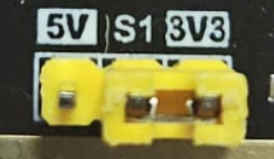

Ahora conectamos los cables hembra a los pines RXD, GND y TXD, debe de quedar así: **(recomiendo usar diferentes colores para los cables asi sabemos cual es cual)**

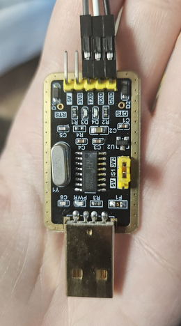

**(Antes de nada, asegura que tienes baterias NUEVAS en el paradise, ya que si se termina la conexión a mitad puedes perder datos o peor, corromperlos, dejando el paradise tieso)**

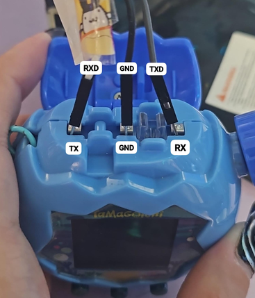

Ahora debemos de conectar los cables al paradise, deben de estar asi conectados:

Y ya lo podemos conectar al pc, quedará algo así:
**(Hay que asegurar que no se muevan los cables del paradise, deben de estar bien pinchados ya que si se mueven en el proceso se pueden corromper los datos)**

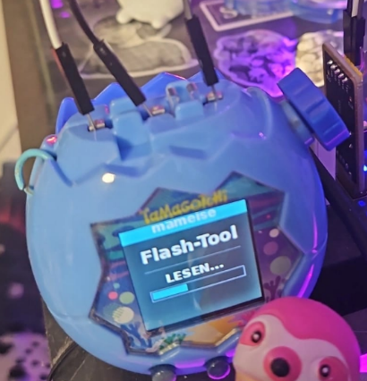

Y vamos al paramix:
<https://mameise.github.io/Paramix-Studio/> 

Dentro de la web debemos de ir a **Device** y se nos desplegará el apartado.

Ahora, en nuestro paradise (ya conectados los pinchos al tamagotchi y el usb al pc), debemos de ir al menú del planeta -> Conexión -> Descargar -> Descargar.

Le damos a connect en el paramix.

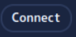

Se abrirá una pop up (ventana emergente) pidiendo un conector serial (yo uso opera gx y me aparecen así los serial).

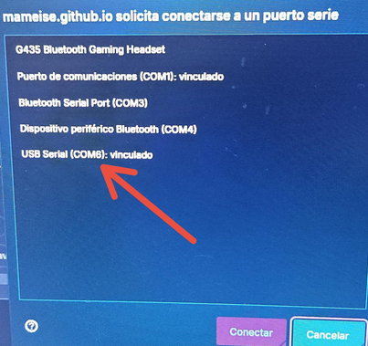

Le damos a conectar.
Nos aparecerá Conectando en nuestro paradise. 

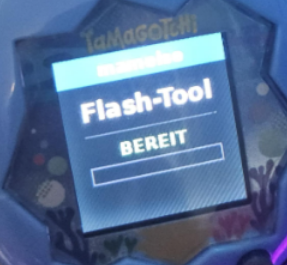

Una vez conectado, nos aparecerá así en la pantalla del paradise: BEREIT (Significa “Listo”).

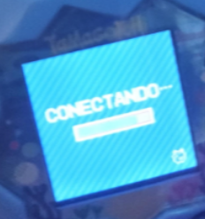

Ahora le damos a **Read ROM** en el paramix y esperamos.

Veremos algo así en nuestro paradise: 

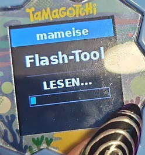

LESEN (Significa “leyendo”).

Una vez ha terminado en nuestro paradise pondrá esto: 

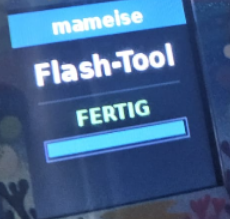

FERTIG (Significa “Terminado”).

Le damos a **backup** (para guardarnos una copia, **muy importante** si no queremos perder nada). 

Saldrá así en el Paradise: SCHREIBEN (Significa “Escribiendo”).

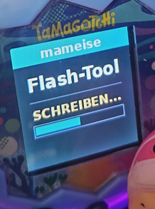

En el paramix nos pondrá algo por ejemplo (Así me aparece a mi en el paramix cuando ha terminado):
**Backed up: water-20261021-2328.tamasave, ps-20261021-2329.sav.** 

**(Seguirá saliendo “Schreiben” en la pantalla del paradise, no preocuparse, eso es que ahora está listo para escribir lo nuevo)**
**(Se nos descargarán tanto nuestra rom como nuestro save a nuestro pc)** 

Ahora veremos que tenemos varias opciones:

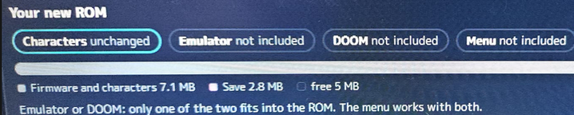

Le damos a **Emulator**.

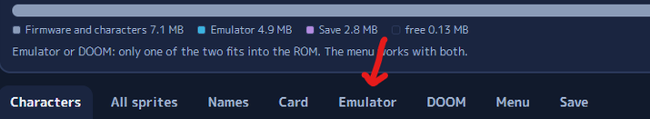

Dentro le damos a: Choose firmware or ROM.

Se nos abrirá una carpeta, tenemos que ir a donde tenemos la rom que queramos meter, yo por ejemplo voy a poner la del ps.

Veremos que ahora nos aparece la ROM elegida y tenemos unas opciones. 

Yo dejo las dos boxes activadas, la de **“Start when switched on”** y la de **“Take the clock from the Paradise at the start”**, el volumen pongo normal (aunque suena flojo) y el brillo lo dejo al 100%. 
La pantalla recomiendo ponerlo de entre **30s o 1m** ni más ni menos, así no gasta tantas pilas o, al contrario, no podremos ver animaciones durante mucho rato.  

Ahora, si nos fijamos, tenemos a la derecha una opción: **Add download content**.
Esta nos permite meterle contenido, por ejemplo, ropa, accesorios, etc. 
Es el mismo procedimiento que meter la rom, se nos abrirá una carpeta y le metemos lo que necesitemos.

Aviso, ocupan espacio, asegurate de tener espacio.

Para terminar, le damos a **“Write new ROM to the device”**.

Y nos dará dos avisos. Una vez aceptemos los dos, empezará a escribir la rom. Tardará unos 10/15 minutos, paciencia.  

Una vez termine saldrá en nuestro paradise otra vez: FERTIG. Y ya lo podemos desconectar.

Ahora, lo reiniciamos (Pinchamos en el botón de reset una vez). Nos aparecerá esto del paradise, le damos a **Continuar**.

Y ponemos la fecha actual.

Acto seguido, nos iniciará el emulador, le damos a **reset** si queremos empezar de cero o a **resume** si queremos continuar la rom (lo más probable es que sea una rom de alguien aleatoria, así que no será ni tu nombre ni tu tama si le das a continuar).

Y ya estaría, para some, meets, on, 4u, 4u+ es igual, asumo que para los demás también.  
(Aún no he probado a ponerle el DOOM)

**Para cambiar entre el Paradise y el otro tama que le hayas metido (yo por ejemplo en el ps) tienes que, desde el otro tama, mantener pulsado el botón de la rueda y entonces entrarás en el paradise, para volver al otro tama desde el paradise, mantener pulsados los botones a + c a la vez (el menú “rodará” pero entonces cambiará al otro tama, paciencia).**

**El reloj se comparte, o eso me parece, yo lo cambio en el paradise y entonces se me actualiza en el PS, pero a veces no lo actualiza solo así que pongo en el paradise la hora y fecha que quiero cambiar y después la misma en el PS.**
